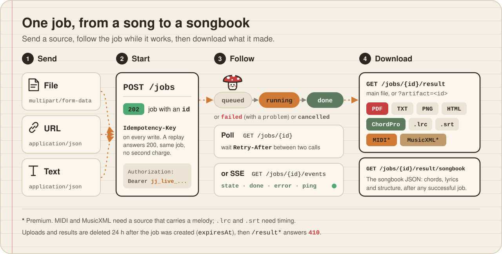
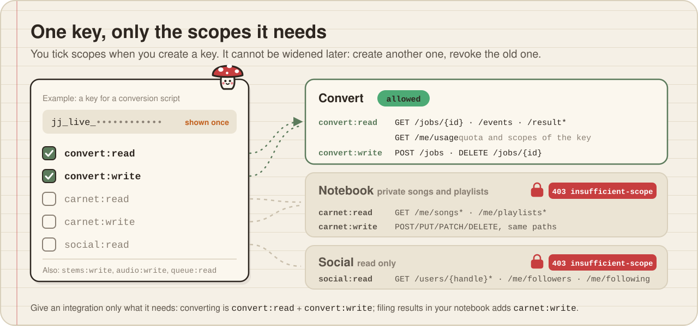

<p align="center">
  
</p>

<p align="center">Part of <b>Jam Jam</b>, a free chord, key and tempo detector: <a href="https://github.com/titouannwtt/jam-jam">overview</a> · <a href="https://jam-jam.org/app/detection">web tool</a> · <a href="https://play.google.com/store/apps/details?id=com.jamjam">Android</a> · <a href="https://testflight.apple.com/join/fx95DYFE">iOS beta</a> · <a href="https://github.com/titouannwtt/jam-jam-assets">models and sounds</a></p>

<p align="center">
  <a href="#quick-start"><b>Quick start</b></a> ·
  <a href="#how-a-job-works"><b>How a job works</b></a> ·
  <a href="#api-keys-and-scopes"><b>Keys and scopes</b></a> ·
  <a href="#main-endpoints"><b>Endpoints</b></a> ·
  <a href="#give-the-api-to-an-ai-assistant"><b>AI assistants</b></a>
</p>

## What is this?

Runnable examples for the [Jam Jam](https://jam-jam.org/?utm_source=github&utm_medium=repo&utm_campaign=api-examples) REST API, in `curl`, JavaScript (Node 20+, no dependency) and Python (3.10+, `requests`). The API turns music files, links and text into a songbook (chords, lyrics, structure) or into portable exports, with the same conversion engine as the Jam Jam app.

What comes out: Jam Jam's songbook format, PDF, plain text, ChordPro, PNG, HTML, synced lyrics (`.lrc`, `.srt`), and, from a source that carries a melody, MIDI and MusicXML. The API can also read and write your private notebook (songs and playlists) and read what other accounts have published.

- **Base URL:** `https://jam-jam.org/api/v1`
- **Contract (OpenAPI 3):** <https://jam-jam.org/api/v1/openapi.json> (source of truth, read it for every field)
- **Documentation:** [jam-jam.org/developers](https://jam-jam.org/developers/?utm_source=github&utm_medium=repo&utm_campaign=api-examples)

The examples were written against contract version 0.6.0. If this README and the contract ever disagree, the contract wins.

## Quick start

**1. Get an API key.** Create a free account at [jam-jam.org](https://jam-jam.org/?utm_source=github&utm_medium=repo&utm_campaign=api-examples), then open **Settings, API keys** in the app (on the web: <https://jam-jam.org/app/prefs/api-keys>) and create a key. Tick the scopes you need: `convert:read` and `convert:write` are enough for the examples below (details in [API keys and scopes](#api-keys-and-scopes)).

**2. Load it.** The key starts with `jj_live_` and is shown once. Copy it into `.env`:

```sh
cp .env.example .env     # then edit .env
set -a; . ./.env; set +a # load it into your shell
```

**3. Convert a song.** From the repository root, with the sample [`samples/amazing-grace.cho`](samples/amazing-grace.cho), a public domain song:

```sh
curl/03-convert-text.sh txt                 # ChordPro text -> plain text, prints the job (note its "id")
curl/04-poll-job.sh <job_id>                # poll until done
curl/06-download-result.sh <job_id>         # saves the file in ./out
```

That is the whole loop. The same thing exists in [JavaScript](#javascript-node-20-no-dependency) and [Python](#python-310) below.

## Examples

All examples read `JAM_JAM_API_KEY` from the environment and run from anywhere in the repository. The default source is [`samples/amazing-grace.cho`](samples/amazing-grace.cho).

### curl

```sh
curl/01-list-formats.sh                     # no key needed
curl/03-convert-text.sh txt                 # ChordPro text -> plain text, prints the job (note its "id")
curl/04-poll-job.sh <job_id>                # poll until done
curl/06-download-result.sh <job_id>         # saves the file in ./out
curl/07-download-songbook.sh <job_id>       # the songbook JSON
```

Other scripts: `02-convert-file.sh` (upload), `05-follow-job-sse.sh` (Server-Sent Events), `08-usage.sh`.

The same thing by hand:

```sh
curl -X POST https://jam-jam.org/api/v1/jobs \
  -H "Authorization: Bearer $JAM_JAM_API_KEY" \
  -H "Idempotency-Key: my-first-job-$(date +%s)" \
  -F file=@samples/amazing-grace.cho \
  -F inputFormat=chordpro \
  -F output=pdf-chords
```

### JavaScript (Node 20+, no dependency)

```sh
cd javascript
node list-formats.mjs [inputFormat]
node convert.mjs text                                  # the sample song -> pdf-chords
node convert.mjs text ../samples/amazing-grace.cho --output txt
node convert.mjs file ../samples/amazing-grace.cho --output chordpro --input chordpro
node convert.mjs url https://example.com/a-page-you-may-convert --output songbook
node follow-events.mjs <job_id>
node usage.mjs
node notebook.mjs list     # needs carnet:read
node notebook.mjs add      # needs carnet:write, adds a public domain song
```

<details>
<summary><b>The core of it</b> (<code>lib.mjs</code>)</summary>

```js
const API = 'https://jam-jam.org/api/v1';
const headers = process.env.JAM_JAM_API_KEY
  ? { Authorization: `Bearer ${process.env.JAM_JAM_API_KEY}` }
  : {};

let res = await fetch(`${API}/jobs`, {
  method: 'POST',
  headers: { ...headers, 'Content-Type': 'application/json', 'Idempotency-Key': crypto.randomUUID() },
  body: JSON.stringify({ text: '{title: Demo}\n[C]Hello [G]world', inputFormat: 'chordpro', output: 'txt' }),
});
let job = await res.json();

while (!['done', 'failed', 'cancelled'].includes(job.phase)) {
  await new Promise((r) => setTimeout(r, (Number(res.headers.get('retry-after')) || 2) * 1000));
  res = await fetch(`${API}/jobs/${job.id}`, { headers });
  job = await res.json();
}
```

</details>

### Python (3.10+)

```sh
cd python
pip install -r requirements.txt
python list_formats.py [input_format]
python convert.py text                                 # the sample song -> pdf-chords
python convert.py file ../samples/amazing-grace.cho --output txt --input chordpro
python convert.py url https://example.com/a-page-you-may-convert --output songbook
python follow_events.py <job_id>
python usage.py
python notebook.py list    # needs carnet:read
python notebook.py add     # needs carnet:write
```

<details>
<summary><b>The core of it</b> (<code>jamjam.py</code>)</summary>

```python
import os, time, uuid, requests

API = "https://jam-jam.org/api/v1"
HEADERS = {"Authorization": f"Bearer {os.environ['JAM_JAM_API_KEY']}"} if os.environ.get("JAM_JAM_API_KEY") else {}

res = requests.post(f"{API}/jobs", headers={**HEADERS, "Idempotency-Key": str(uuid.uuid4())},
                    json={"text": "{title: Demo}\n[C]Hello [G]world", "inputFormat": "chordpro", "output": "txt"})
res.raise_for_status()
job = res.json()

while job["phase"] not in ("done", "failed", "cancelled"):
    time.sleep(int(res.headers.get("Retry-After") or 2))
    res = requests.get(f"{API}/jobs/{job['id']}", headers=HEADERS)
    job = res.json()
```

</details>

## How a job works

<p align="center"></p>

1. **Start.** `POST /jobs` takes a file (`multipart/form-data`), a URL or text (`application/json`). It answers `202` with a job; a replayed `Idempotency-Key` answers `200` with the same job.
2. **Follow.** Poll `GET /jobs/{id}` and honour `Retry-After`, or open `GET /jobs/{id}/events` for the same progress as Server-Sent Events (`state`, `done`, `error`, `ping`).
3. **Download.** `GET /jobs/{id}/result` gives the main result file (`?artifact=<id>` for another one), and `GET /jobs/{id}/result/songbook` the songbook JSON, available after any successful job.

The job fields used here: `id`, `phase` (`queued`, `running`, `done`, `failed`, `cancelled`), `percent`, `inputFormat`, `outputFormat`, `expiresAt`, `steps`, `artifacts` (`id`, `kind`, `format`, `mediaType`, `bytes`, `sha256`, `filename`), `problem` (set when `phase` is `failed`) and `links`.

## API keys and scopes

<p align="center"></p>

- Create keys in the app (web or mobile): **Settings, API keys** (on the web: <https://jam-jam.org/app/prefs/api-keys>).
- **Tick the scopes you need.** A key cannot be widened afterwards: create another one and revoke the old one.
- The key starts with `jj_live_` and is shown once. You can have up to 5 keys per account, each revocable at any time.
- Never commit a real key (`.env` is in `.gitignore`).

| Scope | What it allows |
|---|---|
| `convert:read` | `GET /jobs/{id}`, `/jobs/{id}/events`, `/jobs/{id}/result*`, `/me/usage` |
| `convert:write` | `POST /jobs`, `DELETE /jobs/{id}` |
| `carnet:read` | `GET /me/songs*`, `GET /me/playlists*`, `/me/usage` |
| `carnet:write` | `POST/PUT/PATCH/DELETE` on `/me/songs*` and `/me/playlists*`, `/me/usage` |
| `social:read` | `GET /users/{handle}*`, `/me/followers`, `/me/following`, `/me/usage` |
| `stems:write`, `audio:write`, `queue:read` | stem separation and the audio processing queue, see the contract |

A missing scope answers `403` with `code: insufficient-scope`. Give an integration only what it needs: converting needs `convert:write` and `convert:read`; importing songs into your notebook adds `carnet:write`.

### Anonymous calls

`GET /formats`, `GET /health` and `GET /openapi.json` need no key. The contract also describes anonymous conversions (no `Authorization` header, a very small quota).

> [!NOTE]
> In practice the anti-bot protection in front of the API can answer `403` (an HTML challenge, not an API error) to scripts that send no key, so plan on using a key. The examples only send the `Authorization` header when `JAM_JAM_API_KEY` is set.

## Quotas

Three independent counters, taken from the contract. The exact balance, window and reset time of your identity is always in `GET /me/usage` and in the response headers (`X-Quota-*` for conversions, `X-Read-Quota-*`, `X-Write-Quota-*`).

| Counter | Free account | Premium | Anonymous |
|---|---|---|---|
| Conversions (`POST /jobs`, same counter as exporting from the notebook in the app) | 10 per week | 500 per month | 3 per 24 hours |
| Reads (`/me/songs*`, `/me/playlists*`, `/users/*`, followers) | 2000 per day | 20000 per day | none |
| Notebook writes | 200 per day | 5000 per day | none |

Stem separation has its own counter (10 per day free, 200 per day Premium), and API keys need Premium for it. Going over a limit answers `429` with a `Retry-After` header: wait that long instead of retrying in a loop.

## Main endpoints

| Method | Path | Scope | What it does |
|---|---|---|---|
| GET | `/formats` | none | Input and output formats this server serves, with limits and tiers |
| POST | `/jobs` | `convert:write` | Start a conversion: a file (`multipart/form-data`), a URL or text (`application/json`) |
| GET | `/jobs/{id}` | `convert:read` | Job state (poll, honour `Retry-After`) |
| GET | `/jobs/{id}/events` | `convert:read` | The same progress as Server-Sent Events (`state`, `done`, `error`, `ping`) |
| GET | `/jobs/{id}/result` | `convert:read` | Download the main result file (`?artifact=<id>` for another one) |
| GET | `/jobs/{id}/result/songbook` | `convert:read` | The songbook JSON, available after any successful job |
| DELETE | `/jobs/{id}` | `convert:write` | Cancel a job and erase its files |
| GET | `/me/usage` | any of `convert:read`, `carnet:read`, `carnet:write`, `social:read` | Quota balances and the scopes of your key |
| GET, POST | `/me/songs` | `carnet:read`, `carnet:write` | List (cursor pagination) or add a song to your private notebook |
| GET, PUT, PATCH, DELETE | `/me/songs/{songId}` | `carnet:read`, `carnet:write` | One song |
| GET, POST | `/me/playlists` | `carnet:read`, `carnet:write` | List or create playlists |
| GET, PUT, PATCH, DELETE | `/me/playlists/{playlistId}` | `carnet:read`, `carnet:write` | One playlist |
| GET | `/users/{handle}`, `/users/{handle}/songs`, `/users/{handle}/playlists`, `/me/followers`, `/me/following` | `social:read` | Read-only view of published profiles |

The contract also covers the audio processing queue (`/audio`, `/queue`) and stem separation (`/stem-tool/*`). There is no social write: following, publishing and liking stay gestures made in the app (the only exception is the `publish` field on a song you own, with an explicit rights declaration).

## Formats

Ask the server, do not guess: `GET /formats` lists every format with `served: true|false`. Pass the id in `inputFormat` and `output`.

```sh
curl https://jam-jam.org/api/v1/formats                    # everything
curl "https://jam-jam.org/api/v1/formats?input=chordpro"   # what can be produced from ChordPro, and why not
```

A few things worth knowing, all visible in that response:

- `output` ids are things like `songbook`, `pdf-chords`, `pdf-lyrics`, `txt`, `chordpro`, `html`, `png`, `lrc`, `srt`, `midi`, `musicxml`. Note that `pdf-songbook` is an **input** id (a PDF made by Jam Jam), not an output.
- `requiresAccount: true` on an output (for example `songbook`) means a key is needed. The songbook JSON is nevertheless available from `GET /jobs/{id}/result/songbook` after any successful job.
- `tier: premium` (today `midi` and `musicxml`) needs a Premium account.
- An output only makes sense when the source carries what it needs: `midi` and `musicxml` need a melody, `lrc` and `srt` need timing. `?input=` tells you with `allowed` and `reason`.
- Each input has its own limits (`maxBytes`, `maxPages`, `maxDurationS`).

## Give the API to an AI assistant

The contract is written to be read by an agent. Give your assistant two things, or use the official MCP server below.

1. The address of the contract: `https://jam-jam.org/api/v1/openapi.json`
2. An API key limited to the scopes the task needs (for example `convert:read` and `convert:write` to convert, plus `carnet:write` to file the result in your notebook). Pass it as `Authorization: Bearer <key>`; do not paste it in a shared conversation you do not control.

A prompt that works well:

> Read https://jam-jam.org/api/v1/openapi.json. Call GET /formats first and only use ids with served=true. Send an Idempotency-Key on every write. On a 429, wait for Retry-After. Use GET /me/usage to check my quota and scopes before starting.

Revoke the key in the app when the task is done.

### Official MCP server

For assistants that speak the [Model Context Protocol](https://modelcontextprotocol.io) (Claude Desktop, Claude Code, Cursor and other MCP clients), the official server [`@jam-jam/convert-mcp`](https://www.npmjs.com/package/@jam-jam/convert-mcp) exposes the same API as typed tools: conversion, your notebook (read and write) and public profiles. It only offers the tools that the scopes of your key allow.

```json
{
  "mcpServers": {
    "jam-jam": {
      "command": "npx",
      "args": ["-y", "@jam-jam/convert-mcp"],
      "env": { "JAM_JAM_API_KEY": "jj_live_..." }
    }
  }
}
```

The key goes in the environment, never on a command line. Full list of tools and options: the [package page](https://www.npmjs.com/package/@jam-jam/convert-mcp) and [jam-jam.org/developers](https://jam-jam.org/developers/?utm_source=github&utm_medium=repo&utm_campaign=api-examples).

## Errors, retries, retention

- Every error is an `application/problem+json` object ([RFC 9457](https://www.rfc-editor.org/rfc/rfc9457)) with `type`, `title`, `status` and a stable `code` to test (`insufficient-scope`, `quota-exhausted`, `unsupported-pair`, `invalid-token`, and so on, listed in the contract). Quota errors also carry `retryAfter` and the `quota` state.
- Put an `Idempotency-Key` header (up to 200 characters) on every write. Replaying the same key and body returns the same result without a second charge (for notebook writes, the same key with a different body is `422 idempotency-conflict`).
- Uploaded files and generated results are deleted 24 hours after the job was created (`expiresAt`). After that, `GET /jobs/{id}/result*` answers `410`. There is no longer retention, including after a failure.
- Your notebook is private: an id that does not exist and an id that belongs to someone else give the same `404`.

## Rights

Only convert content you have the right to use, and only submit audio you hold the rights over. The sample in [`samples/`](samples/amazing-grace.cho) is "Amazing Grace": the words are by John Newton (1779) and the melody is traditional, both in the public domain; the chord marks are a simple harmonization written for this repository. Please keep your own demos to public domain or your own material too.

## Security

See [SECURITY.md](SECURITY.md).

## License

The examples in this repository are released under the [MIT License](LICENSE). The Jam Jam API and service are governed by the [Jam Jam terms](https://jam-jam.org/terms/) and [privacy policy](https://jam-jam.org/privacy-policy/); the license of this repository does not cover them.
